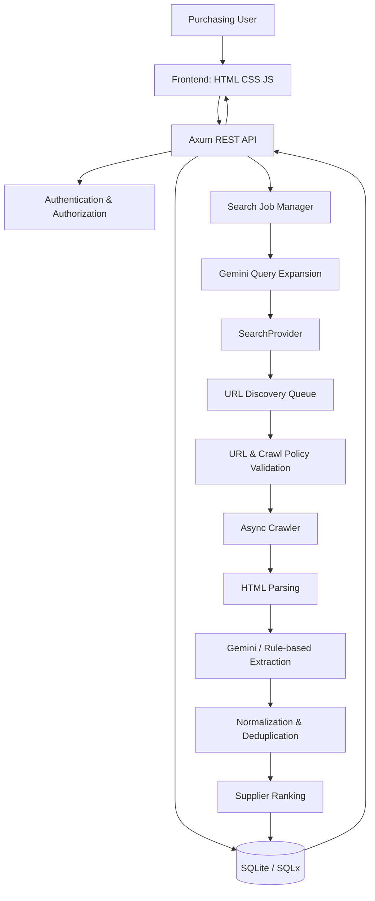

# ProcureAI

**AI-powered Supplier Discovery & Procurement Intelligence**

ProcureAI adalah aplikasi internal untuk membantu tim purchasing menemukan, mengumpulkan, memeriksa, dan membandingkan calon supplier dari berbagai sumber publik di seluruh dunia.

Aplikasi ini menggunakan **Rust + Axum** sebagai backend, **Gemini API** untuk memahami kebutuhan dan menganalisis informasi, **Search API** untuk menemukan halaman web, serta **crawler** untuk mengambil konten halaman publik yang relevan.

> Dokumen ini adalah rencana implementasi bertahap. Fitur yang belum selesai tidak boleh dianggap sudah tersedia. Bangun dan uji setiap tahap sebelum melanjutkan ke tahap berikutnya.

---

## Daftar Isi

- [1. Tujuan Produk](#1-tujuan-produk)
- [2. Ruang Lingkup dan Batasan](#2-ruang-lingkup-dan-batasan)
- [3. Keputusan Teknologi](#3-keputusan-teknologi)
- [4. Arsitektur Sistem](#4-arsitektur-sistem)
- [5. Alur Deep Search](#5-alur-deep-search)
- [6. Struktur Direktori](#6-struktur-direktori)
- [7. Rancangan Database](#7-rancangan-database)
- [8. Rancangan REST API](#8-rancangan-rest-api)
- [9. Konfigurasi Environment](#9-konfigurasi-environment)
- [10. Langkah Implementasi](#10-langkah-implementasi)
- [11. Strategi Ranking Supplier](#11-strategi-ranking-supplier)
- [12. Keamanan dan Kepatuhan Crawler](#12-keamanan-dan-kepatuhan-crawler)
- [13. Pengujian dan Kriteria Selesai](#13-pengujian-dan-kriteria-selesai)
- [14. Deployment](#14-deployment)
- [15. Risiko dan Catatan](#15-risiko-dan-catatan)
- [16. Checklist Proyek](#16-checklist-proyek)

---

## 1. Tujuan Produk

### 1.1 Masalah yang ingin diselesaikan

Pencarian calon supplier dapat menghabiskan waktu karena informasi tersebar di website perusahaan, katalog produk, direktori bisnis, dan sumber publik lainnya. ProcureAI bertujuan mengurangi pekerjaan pencarian dan pencatatan awal tersebut.

### 1.2 Tujuan utama

1. Menerima kebutuhan barang atau material dalam bahasa natural.
2. Mengembangkan kebutuhan tersebut menjadi beberapa kata kunci pencarian.
3. Menelusuri hasil Search API secara bertahap atau *deep search*.
4. Mengunjungi halaman publik yang relevan dan mengekstrak informasi supplier.
5. Menggabungkan data duplikat tanpa menghilangkan sumber aslinya.
6. Memberikan skor relevansi yang transparan dan dapat diperiksa.
7. Menampilkan sumber bukti untuk setiap informasi penting.
8. Menyimpan hasil agar tim purchasing dapat meninjau dan memperbaruinya.
9. Mengekspor hasil pencarian ke Excel pada tahap pengembangan lanjutan.

### 1.3 Pengguna

Aplikasi ditujukan untuk **pengguna internal bagian purchasing**. Tidak ada portal publik bagi supplier pada versi awal.

---

## 2. Ruang Lingkup dan Batasan

| Aspek | Keputusan |
|---|---|
| Jangkauan pencarian | Seluruh dunia |
| Kategori barang | Fleksibel, mengikuti kebutuhan perusahaan |
| Pengguna | Internal purchasing |
| Backend | Rust + Axum |
| AI | Gemini API, nama model melalui konfigurasi |
| Pencarian web | External Search API yang mendukung pagination |
| Crawling | Halaman web publik yang boleh diakses |
| Database awal | SQLite |
| Frontend | HTML, CSS, JavaScript |
| Bahasa antarmuka | Dapat dimulai dalam Bahasa Indonesia |

### 2.1 Bukan tujuan versi awal

- Melakukan pemesanan atau pembayaran otomatis.
- Menyetujui supplier secara otomatis.
- Menjamin supplier benar-benar sah hanya berdasarkan hasil AI.
- Mengakses website yang memerlukan login, CAPTCHA, atau bypass proteksi.
- Mengambil data dari area privat, panel admin, atau endpoint internal.
- Menjamin harga yang ditemukan masih berlaku.
- Meng-crawl seluruh internet tanpa batas.

### 2.2 Arti “sebanyak mungkin”

Tidak ada target jumlah supplier tetap per pencarian. Sistem akan terus melakukan discovery selama masih ada sumber relevan dan anggaran pencarian tersedia.

Namun, setiap pekerjaan tetap harus mempunyai batas operasional yang dapat dikonfigurasi, seperti:

- batas waktu satu pekerjaan;
- jumlah maksimum putaran query;
- jumlah maksimum halaman per query;
- jumlah maksimum URL yang diproses;
- batas request per domain;
- batas biaya atau kuota Search API dan Gemini;
- tombol **Stop Search**.

Batas tersebut bukan target jumlah supplier. Tujuannya mencegah proses berjalan tanpa akhir, menghabiskan kuota, atau membebani website pihak lain.

---

## 3. Keputusan Teknologi

**Rust dipilih sebagai backend utama.** Proyek ini tidak menggunakan Flask dan tidak membutuhkan `requirements.txt`.

| Komponen | Teknologi | Tanggung jawab |
|---|---|---|
| HTTP server | Axum | REST API dan routing |
| Async runtime | Tokio | Menjalankan I/O asynchronous dan worker |
| HTTP client | Reqwest | Memanggil Search API, Gemini API, dan halaman web |
| HTML parser | Scraper | Membaca elemen HTML |
| JSON | Serde + serde_json | Serialisasi dan validasi data |
| Database | SQLite + SQLx | Penyimpanan data awal dan query SQL |
| AI | Gemini API | Query expansion, klasifikasi, dan ekstraksi terstruktur |
| Search | External Search API | Menemukan URL dan mengambil hasil per halaman |
| Logging | tracing | Log aplikasi dan pekerjaan crawler |
| Config | dotenvy | Membaca konfigurasi lokal dari `.env` |
| Export | rust_xlsxwriter (tahap lanjutan) | Membuat file Excel |
| Frontend | HTML, CSS, JavaScript | Dashboard pengguna |

### 3.1 Catatan pemilihan Gemini

Nama model harus dapat diubah melalui `GEMINI_MODEL`. Jangan mengasumsikan nama alias seperti `gemini-lite-latest` selalu tersedia. Sebelum integrasi, periksa nama model yang benar-benar tersedia pada akun dan API yang digunakan.

Untuk tahap awal, panggil Gemini REST API menggunakan Reqwest. Cara ini membuat integrasi tidak bergantung pada satu SDK tertentu. Buat interface/service tersendiri agar provider AI dapat diganti jika diperlukan.

### 3.2 Catatan Search API

Buat abstraksi `SearchProvider`. Adapter pertama dapat dibuat untuk provider yang dipilih setelah membandingkan harga, kuota, negara yang didukung, kualitas hasil, dan dukungan pagination.

Jangan mengikat logika aplikasi ke format respons satu provider. Normalisasikan setiap respons menjadi struktur internal yang sama.

---

## 4. Arsitektur Sistem



### 4.1 Tanggung jawab komponen

- **Frontend:** mengirim permintaan pencarian, menampilkan progres, hasil, detail supplier, dan tindakan pengguna.
- **Axum API:** validasi request, autentikasi, otorisasi, dan pengelolaan pekerjaan.
- **Search Job Manager:** membuat, menghentikan, dan memantau pekerjaan pencarian.
- **Gemini Service:** membuat variasi query dan mengubah konten menjadi data terstruktur.
- **SearchProvider:** mengambil hasil Search API dengan pagination.
- **Crawler:** mengambil konten halaman publik dengan concurrency dan rate limit yang terkendali.
- **Data Processor:** normalisasi, deduplikasi, validasi, dan ranking.
- **Database:** menyimpan pekerjaan, URL yang ditemukan, supplier, sumber bukti, dan hasil pencarian.

### 4.2 Prinsip desain

1. Setiap service memiliki tanggung jawab yang jelas.
2. Search API, Gemini, crawler, dan database tidak dicampur dalam handler HTTP.
3. Pekerjaan crawling berjalan di background, bukan selama request HTTP pengguna terbuka.
4. Semua hasil AI dianggap sebagai data yang belum dipercaya sampai divalidasi.
5. Setiap informasi supplier yang ditampilkan harus memiliki jejak sumber jika tersedia.
6. Provider eksternal dibuat dapat diganti melalui interface/trait.

---

## 5. Alur Deep Search

### 5.1 Alur dari sisi pengguna

1. Pengguna login ke aplikasi.
2. Pengguna memasukkan kebutuhan barang, spesifikasi, dan preferensi lokasi.
3. Backend membuat `search_job` dengan status `queued`.
4. Worker mengambil pekerjaan tersebut.
5. Gemini mengembangkan kebutuhan menjadi beberapa query pencarian.
6. Search API dipanggil untuk setiap query dan halaman hasil.
7. URL dinormalisasi dan diperiksa agar tidak diproses berulang.
8. URL yang lolos pemeriksaan dimasukkan ke antrean crawler.
9. Crawler mengambil halaman publik yang diizinkan.
10. Parser mengekstrak teks, judul, metadata, tautan kontak, dan informasi produk.
11. Gemini atau extractor berbasis aturan mengubah konten menjadi struktur supplier.
12. Sistem memvalidasi, menormalisasi, dan menggabungkan data duplikat.
13. Sistem menghitung skor relevansi dan menyimpan hasil.
14. Dashboard memperlihatkan progres serta hasil yang terus bertambah.
15. Pekerjaan selesai ketika sumber baru habis, kondisi berhenti terpenuhi, atau batas operasional tercapai.

### 5.2 Contoh query expansion

Input pengguna:

> Cari supplier industrial bearing SKF 6205 untuk pengadaan perusahaan. Prioritaskan supplier yang melayani pengiriman internasional.

Contoh variasi query yang dapat dihasilkan:

- `SKF 6205 bearing supplier`
- `SKF 6205 authorized distributor`
- `industrial bearing supplier international shipping`
- `SKF 6205 wholesale supplier`
- `SKF 6205 bearing company catalog`

Query harus tetap mempertahankan merek, tipe, ukuran, dan spesifikasi penting. AI tidak boleh mengganti spesifikasi teknis tanpa menandainya sebagai alternatif.

### 5.3 Discovery loop

Pseudocode berikut menjelaskan logika, bukan implementasi final:

```text
create search job
queries = expand user request

while job is active and operational budget remains:
    for each query that has not been exhausted:
        results = search_provider.search(query, next_page)
        normalize and deduplicate result URLs
        save discovered URLs
        enqueue eligible URLs

    crawl eligible URLs with bounded concurrency
    extract supplier candidates
    validate and normalize candidate data
    deduplicate suppliers
    calculate relevance scores
    persist sources and results

    if several rounds produce no new relevant URLs:
        mark job as completed
        stop

mark job completed, stopped, or failed
```

### 5.4 Kondisi berhenti

Pekerjaan berhenti ketika salah satu kondisi berikut terpenuhi:

- Pengguna menekan Stop.
- Semua query dan halaman yang tersedia sudah habis.
- Beberapa putaran berturut-turut tidak menemukan URL relevan baru.
- Anggaran waktu, request, token, atau biaya tercapai.
- Provider mengembalikan error permanen atau kuota habis.
- Terjadi kesalahan yang membuat pekerjaan tidak aman untuk dilanjutkan.

Status akhir minimal: `completed`, `stopped`, atau `failed`. Status antara lain: `queued`, `running`, dan `stopping`.

---

## 6. Struktur Direktori

Struktur yang disarankan:

```text
procure-ai/
├── Cargo.toml
├── Cargo.lock
├── .env
├── .env.example
├── .gitignore
├── README.md
│
├── migrations/
│   └── 0001_initial.sql
│
├── src/
│   ├── main.rs
│   ├── lib.rs
│   ├── config.rs
│   ├── state.rs
│   │
│   ├── api/
│   │   ├── mod.rs
│   │   ├── health.rs
│   │   ├── auth.rs
│   │   ├── searches.rs
│   │   ├── suppliers.rs
│   │   └── dashboard.rs
│   │
│   ├── auth/
│   │   ├── mod.rs
│   │   ├── password.rs
│   │   └── session.rs
│   │
│   ├── database/
│   │   ├── mod.rs
│   │   └── repositories/
│   │       ├── mod.rs
│   │       ├── searches.rs
│   │       └── suppliers.rs
│   │
│   ├── models/
│   │   ├── mod.rs
│   │   ├── user.rs
│   │   ├── search_job.rs
│   │   ├── search_query.rs
│   │   ├── crawl_page.rs
│   │   ├── supplier.rs
│   │   └── supplier_source.rs
│   │
│   ├── providers/
│   │   ├── mod.rs
│   │   ├── search/
│   │   │   ├── mod.rs
│   │   │   ├── traits.rs
│   │   │   └── provider_adapter.rs
│   │   └── gemini.rs
│   │
│   ├── services/
│   │   ├── mod.rs
│   │   ├── query_expansion.rs
│   │   ├── crawler.rs
│   │   ├── extraction.rs
│   │   ├── normalization.rs
│   │   ├── deduplication.rs
│   │   └── ranking.rs
│   │
│   ├── workers/
│   │   ├── mod.rs
│   │   └── discovery.rs
│   │
│   └── utils/
│       ├── mod.rs
│       ├── url_safety.rs
│       └── text.rs
│
├── frontend/
│   ├── index.html
│   ├── login.html
│   ├── dashboard.html
│   ├── search.html
│   ├── suppliers.html
│   ├── css/
│   └── js/
│
├── tests/
│   ├── api_health.rs
│   ├── normalization.rs
│   └── deduplication.rs
│
└── exports/
```

Folder `exports/` dan database lokal sebaiknya tidak dimasukkan ke Git jika berisi data operasional.

---

## 7. Rancangan Database

Database awal menggunakan SQLite. Aktifkan foreign key pada koneksi dan gunakan migration SQL agar perubahan skema dapat dilacak.

### 7.1 Tabel inti

| Tabel | Tujuan |
|---|---|
| `users` | Akun internal purchasing |
| `search_jobs` | Satu sesi pencarian yang dibuat pengguna |
| `search_queries` | Query turunan dan progres pagination |
| `crawl_pages` | Antrean dan status URL yang ditemukan |
| `suppliers` | Identitas utama/canonical supplier |
| `supplier_sources` | Bukti dan halaman asal informasi supplier |
| `supplier_products` | Produk, spesifikasi, dan harga yang ditemukan |
| `search_results` | Hubungan supplier dengan pekerjaan pencarian dan skornya |

Delapan tabel di atas sengaja memisahkan identitas supplier dari produk dan sumbernya. Satu supplier dapat memiliki banyak produk dan banyak halaman sumber.

### 7.2 SQL migration awal

Buat file `migrations/0001_initial.sql`:

```sql
PRAGMA foreign_keys = ON;

CREATE TABLE users (
    id INTEGER PRIMARY KEY AUTOINCREMENT,
    username TEXT NOT NULL UNIQUE,
    password_hash TEXT NOT NULL,
    role TEXT NOT NULL DEFAULT 'purchasing',
    is_active INTEGER NOT NULL DEFAULT 1,
    created_at TEXT NOT NULL DEFAULT CURRENT_TIMESTAMP
);

CREATE TABLE search_jobs (
    id INTEGER PRIMARY KEY AUTOINCREMENT,
    user_id INTEGER NOT NULL,
    original_request TEXT NOT NULL,
    status TEXT NOT NULL DEFAULT 'queued',
    options_json TEXT,
    stop_requested INTEGER NOT NULL DEFAULT 0,
    round_count INTEGER NOT NULL DEFAULT 0,
    discovered_url_count INTEGER NOT NULL DEFAULT 0,
    processed_url_count INTEGER NOT NULL DEFAULT 0,
    error_message TEXT,
    created_at TEXT NOT NULL DEFAULT CURRENT_TIMESTAMP,
    started_at TEXT,
    finished_at TEXT,
    FOREIGN KEY (user_id) REFERENCES users(id)
);

CREATE TABLE search_queries (
    id INTEGER PRIMARY KEY AUTOINCREMENT,
    job_id INTEGER NOT NULL,
    query_text TEXT NOT NULL,
    provider TEXT NOT NULL,
    page_number INTEGER NOT NULL DEFAULT 1,
    result_count INTEGER NOT NULL DEFAULT 0,
    exhausted INTEGER NOT NULL DEFAULT 0,
    created_at TEXT NOT NULL DEFAULT CURRENT_TIMESTAMP,
    FOREIGN KEY (job_id) REFERENCES search_jobs(id) ON DELETE CASCADE,
    UNIQUE(job_id, provider, query_text, page_number)
);

CREATE TABLE crawl_pages (
    id INTEGER PRIMARY KEY AUTOINCREMENT,
    job_id INTEGER NOT NULL,
    url TEXT NOT NULL,
    normalized_url TEXT NOT NULL,
    domain TEXT NOT NULL,
    status TEXT NOT NULL DEFAULT 'discovered',
    http_status INTEGER,
    page_title TEXT,
    content_hash TEXT,
    error_message TEXT,
    discovered_at TEXT NOT NULL DEFAULT CURRENT_TIMESTAMP,
    fetched_at TEXT,
    FOREIGN KEY (job_id) REFERENCES search_jobs(id) ON DELETE CASCADE,
    UNIQUE(job_id, normalized_url)
);

CREATE TABLE suppliers (
    id INTEGER PRIMARY KEY AUTOINCREMENT,
    canonical_key TEXT NOT NULL UNIQUE,
    company_name TEXT NOT NULL,
    normalized_name TEXT NOT NULL,
    website TEXT,
    domain TEXT,
    country TEXT,
    city TEXT,
    email TEXT,
    phone TEXT,
    category TEXT,
    description TEXT,
    verification_status TEXT NOT NULL DEFAULT 'unverified',
    created_at TEXT NOT NULL DEFAULT CURRENT_TIMESTAMP,
    updated_at TEXT NOT NULL DEFAULT CURRENT_TIMESTAMP
);

CREATE TABLE supplier_sources (
    id INTEGER PRIMARY KEY AUTOINCREMENT,
    supplier_id INTEGER NOT NULL,
    crawl_page_id INTEGER,
    source_url TEXT NOT NULL,
    source_type TEXT,
    evidence_json TEXT,
    extracted_at TEXT NOT NULL DEFAULT CURRENT_TIMESTAMP,
    FOREIGN KEY (supplier_id) REFERENCES suppliers(id) ON DELETE CASCADE,
    FOREIGN KEY (crawl_page_id) REFERENCES crawl_pages(id) ON DELETE SET NULL,
    UNIQUE(supplier_id, source_url)
);

CREATE TABLE supplier_products (
    id INTEGER PRIMARY KEY AUTOINCREMENT,
    supplier_id INTEGER NOT NULL,
    source_id INTEGER,
    product_name TEXT NOT NULL,
    brand TEXT,
    model_or_specification TEXT,
    price_amount REAL,
    price_currency TEXT,
    minimum_order_quantity TEXT,
    availability_note TEXT,
    product_url TEXT,
    price_observed_at TEXT,
    FOREIGN KEY (supplier_id) REFERENCES suppliers(id) ON DELETE CASCADE,
    FOREIGN KEY (source_id) REFERENCES supplier_sources(id) ON DELETE SET NULL
);

CREATE TABLE search_results (
    id INTEGER PRIMARY KEY AUTOINCREMENT,
    job_id INTEGER NOT NULL,
    supplier_id INTEGER NOT NULL,
    relevance_score REAL NOT NULL DEFAULT 0,
    score_breakdown_json TEXT,
    first_seen_at TEXT NOT NULL DEFAULT CURRENT_TIMESTAMP,
    FOREIGN KEY (job_id) REFERENCES search_jobs(id) ON DELETE CASCADE,
    FOREIGN KEY (supplier_id) REFERENCES suppliers(id) ON DELETE CASCADE,
    UNIQUE(job_id, supplier_id)
);

CREATE INDEX idx_jobs_user_created ON search_jobs(user_id, created_at);
CREATE INDEX idx_jobs_status ON search_jobs(status);
CREATE INDEX idx_pages_job_status ON crawl_pages(job_id, status);
CREATE INDEX idx_pages_domain ON crawl_pages(domain);
CREATE INDEX idx_suppliers_name ON suppliers(normalized_name);
CREATE INDEX idx_suppliers_country ON suppliers(country);
CREATE INDEX idx_results_job_score ON search_results(job_id, relevance_score DESC);
CREATE INDEX idx_products_supplier ON supplier_products(supplier_id);
```

### 7.3 Aturan penyimpanan data

- `canonical_key` adalah kunci normalisasi identitas supplier, idealnya berdasarkan domain resmi. Jika domain tidak tersedia, gunakan kombinasi nama normalisasi dan negara dengan penanganan konflik manual.
- Jangan menggabungkan dua perusahaan hanya karena namanya mirip.
- `source_url` harus disimpan untuk setiap klaim penting.
- Harga wajib memiliki mata uang dan tanggal observasi. Harga tanpa sumber atau tanggal tidak boleh dianggap harga terkini.
- Informasi yang tidak ditemukan disimpan sebagai `NULL`, bukan ditebak oleh AI.
- `evidence_json` dan `score_breakdown_json` harus berisi data terstruktur yang tervalidasi.
- Jangan simpan isi penuh halaman website tanpa alasan dan izin yang sesuai. Simpan metadata serta kutipan/evidence seperlunya.

---

## 8. Rancangan REST API

Semua endpoint menggunakan prefix `/api`. Respons menggunakan JSON.

### 8.1 Health dan autentikasi

| Method | Endpoint | Fungsi |
|---|---|---|
| GET | `/api/health` | Pemeriksaan server |
| POST | `/api/auth/login` | Login pengguna |
| POST | `/api/auth/logout` | Logout |
| GET | `/api/auth/me` | Informasi sesi pengguna |

### 8.2 Search jobs

| Method | Endpoint | Fungsi |
|---|---|---|
| POST | `/api/search` | Membuat pekerjaan pencarian |
| GET | `/api/search/:id` | Status dan ringkasan progres |
| POST | `/api/search/:id/stop` | Meminta worker berhenti |
| GET | `/api/search/:id/results` | Mengambil hasil pencarian |
| GET | `/api/search/:id/queries` | Melihat query yang dihasilkan |
| GET | `/api/search/:id/pages` | Melihat URL dan status crawling |
| GET | `/api/search/:id/export` | Mengunduh hasil, tahap lanjutan |

### 8.3 Supplier

| Method | Endpoint | Fungsi |
|---|---|---|
| GET | `/api/suppliers` | Daftar supplier dengan pagination/filter |
| GET | `/api/suppliers/:id` | Detail supplier dan sumber |
| PATCH | `/api/suppliers/:id` | Memperbarui atau mengoreksi data |
| GET | `/api/suppliers/:id/sources` | Daftar sumber bukti |
| GET | `/api/suppliers/:id/products` | Produk supplier |

### 8.4 Dashboard

| Method | Endpoint | Fungsi |
|---|---|---|
| GET | `/api/dashboard` | Statistik ringkasan |

### 8.5 Contoh membuat pencarian

Request:

```http
POST /api/search
Content-Type: application/json
```

```json
{
  "request": "Find manufacturers and distributors of industrial bearings SKF 6205 worldwide",
  "preferences": {
    "countries": [],
    "exclude_marketplaces": false,
    "prioritize_manufacturers": true
  }
}
```

Response `202 Accepted`:

```json
{
  "job_id": 42,
  "status": "queued",
  "message": "Supplier discovery job queued"
}
```

### 8.6 Contoh status pencarian

```json
{
  "job_id": 42,
  "status": "running",
  "round_count": 3,
  "discovered_urls": 87,
  "processed_urls": 41,
  "suppliers_found": 16,
  "message": "Discovering additional sources"
}
```

Angka di atas hanya contoh format respons, bukan hasil pencarian aktual.

### 8.7 Standar respons error

Gunakan format konsisten:

```json
{
  "error": {
    "code": "VALIDATION_ERROR",
    "message": "Search request is required"
  }
}
```

Gunakan status HTTP yang sesuai: `400` untuk request tidak valid, `401` untuk belum login, `403` untuk tidak berwenang, `404` untuk data tidak ditemukan, `409` untuk konflik, `429` untuk rate limit, dan `500` untuk kesalahan internal.

---

## 9. Konfigurasi Environment

Buat `.env.example`:

```dotenv
APP_HOST=127.0.0.1
APP_PORT=8080
APP_ENV=development

DATABASE_URL=sqlite://instance/procure_ai.db

GEMINI_API_KEY=
GEMINI_MODEL=

SEARCH_PROVIDER=
SEARCH_API_KEY=
SEARCH_API_BASE_URL=

SESSION_SECRET=replace-with-a-long-random-secret

MAX_SEARCH_ROUNDS=20
MAX_PAGES_PER_QUERY=10
MAX_URLS_PER_JOB=500
MAX_JOB_DURATION_MINUTES=30
CRAWLER_GLOBAL_CONCURRENCY=5
CRAWLER_PER_DOMAIN_CONCURRENCY=1
CRAWLER_REQUEST_DELAY_MS=1500
CRAWLER_TIMEOUT_SECONDS=15
CRAWLER_MAX_RESPONSE_BYTES=2000000
```

Nilai di atas adalah konfigurasi awal untuk pengembangan dan perlu disesuaikan dengan kuota provider serta kebijakan perusahaan.

Buat `.env` berdasarkan file contoh, lalu isi API key sendiri. **Jangan pernah commit `.env` ke Git.**

Tambahkan ke `.gitignore`:

```gitignore
.env
/target/
/instance/*.db
/exports/*
```

Jangan menaruh API key di JavaScript frontend atau mengirimkannya ke browser.

---

## 10. Langkah Implementasi

Ikuti urutan ini. Pastikan setiap tahap berjalan sebelum lanjut ke tahap berikutnya.

### Tahap 0 — Persiapan lingkungan

**Tujuan:** memastikan toolchain Rust siap.

1. Install Rust stable melalui rustup.
2. Pastikan Cargo tersedia.
3. Install compiler dan dependency sistem yang dibutuhkan SQLite/TLS jika distro memerlukannya.
4. Buat repository Git.

Periksa instalasi:

```bash
rustc --version
cargo --version
rustup show
```

Kriteria selesai:

- `rustc` dan `cargo` berjalan.
- `cargo new` dapat membuat proyek.
- Git repository sudah dibuat.

### Tahap 1 — Bootstrap Axum

**Tujuan:** menjalankan HTTP server sederhana.

```bash
cargo new procure-ai
cd procure-ai
```

Tambahkan dependency awal pada `Cargo.toml`:

```toml
[package]
name = "procure-ai"
version = "0.1.0"
edition = "2024"

[dependencies]
axum = "0.8"
tokio = { version = "1", features = ["full"] }
serde = { version = "1", features = ["derive"] }
serde_json = "1"
tracing = "0.1"
tracing-subscriber = { version = "0.3", features = ["env-filter"] }
dotenvy = "0.15"
```

Ganti `src/main.rs`:

```rust
use axum::{routing::get, Json, Router};
use serde_json::{json, Value};
use tokio::net::TcpListener;

async fn health() -> Json<Value> {
    Json(json!({
        "application": "ProcureAI",
        "status": "running",
        "version": env!("CARGO_PKG_VERSION")
    }))
}

#[tokio::main]
async fn main() -> Result<(), Box<dyn std::error::Error>> {
    dotenvy::dotenv().ok();
    tracing_subscriber::fmt()
        .with_env_filter("info")
        .init();

    let app = Router::new().route("/api/health", get(health));
    let listener = TcpListener::bind("127.0.0.1:8080").await?;

    tracing::info!("ProcureAI listening on http://127.0.0.1:8080");
    axum::serve(listener, app).await?;
    Ok(())
}
```

Jalankan:

```bash
cargo fmt
cargo check
cargo run
```

Tes di terminal lain:

```bash
curl http://127.0.0.1:8080/api/health
```

Kriteria selesai: server hidup dan mengembalikan JSON status `running`.

### Tahap 2 — Konfigurasi dan database

**Tujuan:** menghubungkan Axum ke SQLite dan mengelola schema dengan migration.

Tambahkan dependency:

```toml
sqlx = { version = "0.8", features = [
  "runtime-tokio-rustls", "sqlite", "macros", "chrono", "migrate"
] }
```

Langkah:

1. Buat folder `instance/`.
2. Buat `.env` dan set `DATABASE_URL=sqlite://instance/procure_ai.db`.
3. Buat `migrations/0001_initial.sql` dari rancangan database di atas.
4. Buat module `database` untuk membuat connection pool.
5. Jalankan migration saat startup.
6. Uji insert dan select sederhana.

Kriteria selesai:

- Database otomatis dibuat pada lokasi yang benar.
- Seluruh tabel migration tersedia.
- Foreign key aktif.
- Aplikasi dapat menyimpan dan membaca satu record uji.

### Tahap 3 — Model dan repository

**Tujuan:** memisahkan struktur data dari logika SQL.

Buat model Rust untuk:

- `User`
- `SearchJob`
- `SearchQuery`
- `CrawlPage`
- `Supplier`
- `SupplierSource`
- `SupplierProduct`
- `SearchResult`

Gunakan Serde untuk tipe request/response API. Buat repository khusus untuk operasi database, misalnya `create_job`, `get_job`, `insert_crawl_page`, `upsert_supplier`, dan `list_results`.

Kriteria selesai: handler API tidak berisi query SQL panjang secara langsung.

### Tahap 4 — Autentikasi internal

**Tujuan:** membatasi aplikasi untuk tim purchasing.

Implementasikan:

1. Pembuatan akun awal oleh administrator.
2. Password hashing menggunakan Argon2 atau algoritma password hashing yang setara.
3. Session cookie yang aman atau mekanisme token yang dirancang dengan benar.
4. Middleware autentikasi pada endpoint internal.
5. Role minimal `admin` dan `purchasing`.
6. Proteksi CSRF jika menggunakan cookie session untuk request yang mengubah data.

Jangan menyimpan password dalam bentuk plaintext. Jangan membuat akun default dengan password yang ditulis permanen dalam source code.

Kriteria selesai: endpoint supplier dan search tidak dapat diakses tanpa autentikasi.

### Tahap 5 — Integrasi Gemini

**Tujuan:** mengubah permintaan pengguna menjadi query pencarian yang terstruktur.

Buat `providers/gemini.rs` dengan tanggung jawab:

- Membaca API key dan model dari environment.
- Mengirim prompt melalui Gemini API.
- Meminta output JSON terstruktur.
- Menangani timeout, rate limit, dan error provider.
- Memvalidasi respons ke struct Rust.

Contoh bentuk output internal:

```json
{
  "normalized_requirement": "SKF 6205 deep groove ball bearing",
  "important_specs": ["SKF", "6205"],
  "search_queries": [
    "SKF 6205 bearing supplier",
    "SKF 6205 authorized distributor",
    "SKF 6205 industrial bearing wholesale"
  ]
}
```

Aturan prompt:

- Jangan mengubah model atau ukuran produk.
- Jangan menciptakan nama supplier.
- Kembalikan query, bukan klaim bahwa supplier sudah ditemukan.
- Jika spesifikasi ambigu, tandai bagian yang ambigu.
- Batasi jumlah query per putaran sesuai konfigurasi.

Kriteria selesai: satu request uji dapat menghasilkan daftar query yang valid dan lolos deserialisasi.

### Tahap 6 — SearchProvider dan pagination

**Tujuan:** mendapatkan URL hasil pencarian dari provider eksternal.

Buat trait internal dengan konsep berikut:

```rust
#[async_trait::async_trait]
pub trait SearchProvider: Send + Sync {
    async fn search(
        &self,
        query: &str,
        page: u32,
    ) -> anyhow::Result<SearchPage>;
}
```

`SearchPage` minimal berisi:

- daftar hasil;
- URL;
- judul;
- snippet;
- nomor halaman atau token pagination;
- indikator apakah masih ada halaman berikutnya.

Tambahkan adapter untuk provider yang dipilih. Simpan provider, query, dan nomor halaman pada `search_queries`.

Kriteria selesai:

- API dapat mengambil halaman pertama dan selanjutnya.
- URL yang sama tidak dimasukkan berulang kali untuk job yang sama.
- Error kuota dan rate limit ditangani dengan jelas.

### Tahap 7 — URL validation dan crawler

**Tujuan:** mengambil halaman yang aman dan relevan.

Implementasikan crawler dengan Reqwest dan Scraper. Setiap URL harus melalui pemeriksaan sebelum request.

Pemeriksaan minimum:

- Hanya izinkan skema `http` dan `https`.
- Tolak localhost, loopback, private IP, link-local, multicast, dan alamat metadata cloud.
- Validasi hasil DNS dan alamat tujuan koneksi; jangan hanya memeriksa teks hostname.
- Ulangi pemeriksaan pada redirect dan batasi jumlah redirect.
- Tolak port yang tidak diperlukan.
- Gunakan timeout dan batas ukuran response.
- Terima content type yang memang dapat diproses, terutama `text/html`.
- Batasi concurrency global dan per domain.
- Hormati `robots.txt`, Terms of Service, dan kebijakan akses situs.
- Jangan melewati CAPTCHA, login, paywall, atau mekanisme anti-bot.
- Jangan mengunduh file besar atau tipe file yang tidak diperlukan.

Kriteria selesai: crawler dapat mengambil satu halaman publik yang diizinkan, menyimpan metadata, dan menolak URL internal/private.

### Tahap 8 — Ekstraksi data supplier

**Tujuan:** mengubah konten halaman menjadi kandidat supplier.

Prioritaskan ekstraksi bertahap:

1. Metadata HTML dan structured data yang tersedia secara publik.
2. Teks halaman yang relevan.
3. Email, nomor telepon, alamat, produk, dan tautan katalog jika memang tercantum.
4. Gemini untuk klasifikasi dan ekstraksi ke schema terstruktur.
5. Validasi hasil Gemini di Rust sebelum disimpan.

Field supplier minimal:

- nama perusahaan;
- website/domain;
- negara dan kota jika tercantum;
- kategori;
- deskripsi singkat;
- email dan telepon jika tercantum;
- produk dan spesifikasi;
- URL sumber;
- waktu informasi ditemukan.

Setiap field harus dapat ditelusuri ke sumber. Jangan mengisi data yang tidak ditemukan dengan tebakan.

Kriteria selesai: satu halaman uji menghasilkan kandidat supplier dengan source URL dan field yang tervalidasi.

### Tahap 9 — Normalisasi dan deduplikasi

**Tujuan:** menghindari supplier yang sama tampil berkali-kali.

Urutan deduplikasi yang disarankan:

1. Normalisasi URL dan domain.
2. Gunakan domain resmi sebagai identitas utama jika tersedia.
3. Normalisasi nama perusahaan dan negara sebagai fallback.
4. Bandingkan website, email domain, telepon, dan alamat sebagai sinyal tambahan.
5. Jangan menggabungkan data hanya berdasarkan kemiripan nama.
6. Simpan semua `supplier_sources` walaupun supplier sudah pernah ditemukan.

Jika dua entitas belum dapat dipastikan sama, biarkan terpisah dan tandai untuk pemeriksaan manual.

Kriteria selesai: URL yang sama tidak membuat supplier baru, dan beberapa sumber dapat terhubung ke satu supplier.

### Tahap 10 — Ranking dan hasil pencarian

**Tujuan:** mengurutkan kandidat berdasarkan kecocokan terhadap permintaan pengguna.

Buat skor transparan dari beberapa komponen. Contoh bobot awal tersedia pada [Strategi Ranking Supplier](#11-strategi-ranking-supplier). Simpan detail komponen skor, bukan hanya angka total.

Kriteria selesai:

- Setiap supplier pada hasil memiliki skor dan alasan.
- Informasi yang tidak tersedia ditandai sebagai tidak diketahui.
- Urutan dapat diperiksa dan tidak bergantung pada klaim AI yang tidak bersumber.

### Tahap 11 — Background worker dan kontrol pekerjaan

**Tujuan:** menjalankan deep search tanpa menahan request HTTP.

Untuk versi awal, worker dapat dijalankan dalam proses aplikasi yang sama menggunakan Tokio task dan antrean terkontrol. Job dan statusnya tetap disimpan di database.

Implementasikan:

- mengambil job dengan aman agar tidak diproses dua kali;
- status `queued`, `running`, `stopping`, `completed`, `stopped`, `failed`;
- graceful shutdown;
- pengecekan `stop_requested` secara berkala;
- retry terbatas dengan exponential backoff untuk error sementara;
- batas biaya, waktu, halaman, dan request;
- penyimpanan progres setelah setiap batch.

Untuk deployment yang lebih besar, pisahkan worker menjadi proses/service tersendiri.

Kriteria selesai: pengguna dapat memulai, memantau, dan menghentikan pencarian tanpa menunggu satu request HTTP terbuka.

### Tahap 12 — Frontend purchasing

**Tujuan:** menyediakan antarmuka yang mudah dipakai staf purchasing.

Halaman minimal:

- Login.
- Dashboard ringkasan.
- Form pencarian supplier.
- Detail progres deep search.
- Tabel hasil supplier dengan filter dan sorting.
- Detail supplier dan daftar source.
- Riwayat pencarian.

Tampilan progres sebaiknya menampilkan query yang sedang diproses, jumlah URL ditemukan, jumlah halaman diproses, jumlah kandidat supplier, dan status job. Jangan menampilkan persentase selesai palsu jika total pekerjaan belum diketahui.

Kriteria selesai: seluruh alur pencarian dapat dilakukan dari browser tanpa memakai terminal.

### Tahap 13 — Export dan fitur lanjutan

Setelah alur inti stabil, tambahkan:

- Export Excel.
- Filter negara, kategori, produk, dan verification status.
- Catatan internal purchasing.
- Status `discovered`, `extracted`, `verified`, `contacted`, dan `approved`.
- Perbandingan produk dan harga dengan mata uang serta waktu observasi.
- Pengaturan bobot ranking.

Fitur ini bukan pengganti verifikasi bisnis oleh purchasing.

---

## 11. Strategi Ranking Supplier

Contoh bobot awal yang dapat dikonfigurasi:

| Kriteria | Bobot awal |
|---|---:|
| Kesesuaian produk dan spesifikasi | 40% |
| Kesesuaian lokasi/pengiriman | 20% |
| Kelengkapan informasi perusahaan | 15% |
| Ketersediaan kontak | 10% |
| Informasi harga yang dapat ditelusuri | 15% |
| **Total** | **100%** |

### 11.1 Prinsip perhitungan

- Skor produk harus mempertimbangkan merek, model, ukuran, dan spesifikasi penting.
- Lokasi harus mengikuti preferensi pencarian. Jika pengguna tidak membatasi negara, jangan memberi penalti hanya karena supplier berada di luar negara tertentu.
- Harga hanya dinilai jika tersedia bukti, mata uang, unit, dan waktu observasi yang cukup jelas.
- Jika komponen tidak tersedia, tampilkan `unknown` dan hitung ulang berdasarkan komponen yang memang tersedia atau tampilkan skor dengan coverage yang jelas.
- Pisahkan **relevance score** dari **trust/verification status**. Supplier relevan belum tentu supplier tepercaya.
- Jangan menyebut supplier `verified` hanya karena AI menemukan websitenya.

### 11.2 Penjelasan skor

Setiap hasil sebaiknya memuat:

- skor total;
- rincian skor per kriteria;
- alasan supplier dianggap relevan;
- informasi yang belum ditemukan;
- sumber yang mendukung kecocokan tersebut.

---

## 12. Keamanan dan Kepatuhan Crawler

Crawler harus dirancang dengan prinsip *polite crawling* dan *defense in depth*.

### 12.1 Keamanan jaringan

Cegah SSRF (Server-Side Request Forgery): crawler tidak boleh digunakan untuk mengakses jaringan internal perusahaan, localhost, router, database, service cloud metadata, atau IP privat. Validasi hostname, hasil DNS, alamat IP, dan redirect sebelum setiap koneksi. Untuk perlindungan yang kuat, terapkan pembatasan egress di level sistem operasi/container juga.

### 12.2 Batas akses situs

- Baca dan hormati `robots.txt`.
- Ikuti Terms of Service dan aturan penggunaan Search API.
- Gunakan user-agent yang mengidentifikasi aplikasi.
- Terapkan request delay dan concurrency rendah per domain.
- Jangan bypass login, CAPTCHA, paywall, atau anti-bot.
- Hentikan crawling jika situs menolak akses atau meminta pembatasan.

### 12.3 Perlindungan data

- Simpan API key hanya di server.
- Gunakan autentikasi untuk seluruh data internal.
- Jangan menampilkan stack trace atau secret dalam respons API.
- Batasi akses export dan riwayat pencarian berdasarkan role.
- Catat perubahan manual terhadap data supplier.
- Hindari menyimpan data pribadi yang tidak diperlukan.
- Buat backup database dan kebijakan retensi.

### 12.4 Keandalan dan biaya

- Terapkan timeout pada seluruh request eksternal.
- Gunakan retry terbatas untuk `429` dan error sementara, dengan exponential backoff serta jitter.
- Jangan retry terus-menerus untuk error permanen.
- Catat penggunaan token, jumlah request, dan perkiraan biaya per job.
- Berikan batas anggaran per pekerjaan dan per hari.

---

## 13. Pengujian dan Kriteria Selesai

### 13.1 Jenis pengujian

- Unit test: URL normalization, parsing, scoring, dan deduplication.
- Integration test: database, migration, Search API adapter, dan Gemini adapter.
- API test: status code, validasi request, autentikasi, dan pagination.
- Crawler test: halaman lokal fixture, redirect berbahaya, timeout, ukuran respons, dan content type.
- End-to-end test: buat job sampai hasil tampil di dashboard.

Gunakan fixture HTML lokal untuk sebagian besar tes crawler agar tidak bergantung pada website pihak ketiga.

### 13.2 Definisi MVP selesai

MVP dianggap selesai ketika:

- Pengguna internal dapat login.
- Pengguna dapat mengirim permintaan pencarian.
- Job berjalan di background dan statusnya dapat dipantau.
- Gemini menghasilkan query pencarian terstruktur.
- Search API mengembalikan URL melalui pagination.
- URL divalidasi sebelum crawler mengaksesnya.
- Crawler dapat mengambil halaman publik yang diizinkan.
- Sistem mengekstrak nama supplier dan menyimpan source URL.
- Supplier duplikat dapat dikenali dengan aturan konservatif.
- Hasil memiliki skor relevansi dan alasan.
- Pengguna dapat menghentikan job.
- Data tersimpan dan dapat dibuka kembali.
- API key tidak terekspos ke frontend atau Git.

---

## 14. Deployment

### 14.1 Pengembangan lokal

```bash
cp .env.example .env
# Isi API key dan konfigurasi provider di .env
cargo fmt
cargo check
cargo test
cargo run
```

Aplikasi tahap awal dapat dibuka pada `http://127.0.0.1:8080`.

### 14.2 Deployment internal

Untuk penggunaan kantor:

1. Jalankan service pada server Linux internal atau VM yang disetujui perusahaan.
2. Gunakan reverse proxy HTTPS jika diakses melalui jaringan kantor.
3. Batasi akses dengan firewall atau VPN/jaringan internal.
4. Simpan secret pada environment server, bukan di repository.
5. Jalankan backup database terjadwal.
6. Pisahkan direktori database, log, dan export dari direktori source code.
7. Pantau penggunaan API dan kapasitas disk.
8. Atur restart service dan graceful shutdown.

Jangan membuka aplikasi ke internet publik sebelum autentikasi, HTTPS, session security, rate limit, backup, dan pembatasan akses diuji.

---

## 15. Risiko dan Catatan

| Risiko | Mitigasi |
|---|---|
| Search API memiliki kuota/biaya | Anggaran per job, pagination terkontrol, monitoring |
| Gemini menghasilkan data keliru | Validasi schema, source evidence, status unverified |
| Banyak hasil duplikat | Canonical domain, normalisasi, pemeriksaan manual untuk kasus ambigu |
| Website menolak crawler | Hormati kebijakan akses dan hentikan request |
| Informasi harga sudah lama | Simpan mata uang, URL, dan tanggal observasi |
| Pencarian tidak pernah selesai | Kondisi berhenti dan batas operasional |
| SSRF | Validasi DNS/IP/redirect dan egress firewall |
| Job hilang saat restart | Simpan state/progres ke database dan lakukan recovery |
| SQLite menjadi bottleneck | Mulai dengan SQLite; evaluasi PostgreSQL jika concurrency meningkat |
| Supplier ditemukan tetapi tidak kredibel | Pisahkan relevansi dari verifikasi bisnis |

### 15.1 Batas kualitas data

Hasil pencarian adalah **calon supplier**, bukan daftar supplier yang otomatis disetujui. Purchasing tetap perlu memeriksa legalitas perusahaan, kemampuan memasok, sertifikasi, reputasi, syarat pembayaran, pajak, kualitas, dan ketentuan pengiriman sebelum transaksi.

---

## 16. Checklist Proyek

Gunakan checklist berikut untuk melacak implementasi.

### Fondasi
- [ ] Install Rust stable dan Cargo.
- [ ] Buat repository Git.
- [ ] Bootstrap Axum dan endpoint health.
- [ ] Tambahkan konfigurasi environment.
- [ ] Tambahkan SQLx dan SQLite.
- [ ] Buat migration database.
- [ ] Buat model dan repository.

### Keamanan dan akses
- [ ] Implementasikan login internal.
- [ ] Implementasikan role dan middleware.
- [ ] Lindungi secret dan file database.
- [ ] Implementasikan URL validation anti-SSRF.
- [ ] Implementasikan rate limit dan crawler policy.

### AI dan pencarian
- [ ] Verifikasi model Gemini yang tersedia.
- [ ] Implementasikan Gemini service.
- [ ] Definisikan SearchProvider trait.
- [ ] Pilih dan integrasikan Search API.
- [ ] Implementasikan pagination.
- [ ] Simpan query dan URL discovery.

### Crawling dan data
- [ ] Implementasikan crawler asynchronous.
- [ ] Implementasikan HTML parsing.
- [ ] Implementasikan supplier extraction.
- [ ] Simpan source evidence.
- [ ] Implementasikan normalization.
- [ ] Implementasikan deduplication.
- [ ] Implementasikan ranking dan score breakdown.

### Produk
- [ ] Implementasikan background worker.
- [ ] Implementasikan progress dan Stop Search.
- [ ] Implementasikan endpoint supplier.
- [ ] Buat dashboard frontend.
- [ ] Buat tabel hasil dan detail supplier.
- [ ] Tambahkan search history.
- [ ] Tambahkan export Excel.
- [ ] Lakukan pengujian end-to-end.
- [ ] Siapkan deployment internal dan backup.

---

## Catatan Implementasi Pertama

Mulai dari **Tahap 0 dan Tahap 1 saja**. Jangan langsung mengintegrasikan Gemini, Search API, dan crawler sebelum server dasar berjalan serta endpoint health berhasil diuji.

Urutan kerja yang disarankan pada setiap tahap:

1. Buat satu bagian kecil.
2. Jalankan `cargo fmt`.
3. Jalankan `cargo check`.
4. Jalankan `cargo test` jika sudah ada test.
5. Uji endpoint atau fungsi yang baru dibuat.
6. Commit perubahan yang sudah berhasil.

Dengan cara ini, ketika terjadi error, penyebabnya lebih mudah ditemukan dan proyek tidak berubah menjadi satu tumpukan masalah yang saling bergantung.

**Project name:** ProcureAI  
**Backend:** Rust + Axum  
**Database:** SQLite  
**AI:** Gemini API  
**Search:** Pluggable External Search API  
**Audience:** Internal Purchasing Team
